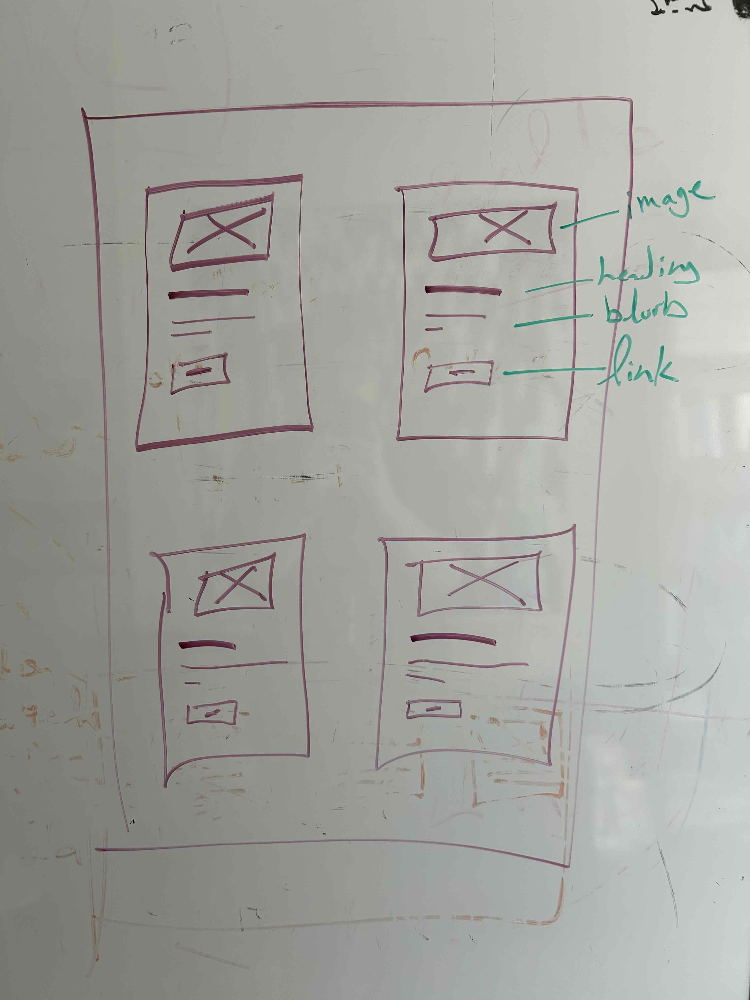

# ENG 317 CSS Practice & Challenge Activities

Repo for practicing HTML and CSS together in class. It will also include our 5-minute challenge activities, which may be graded.

## Folder-File Setup Instructions

1. Copy and paste the `lindgren` folder within the root of this css-practice folder.
    - **WARNING!** Please make sure that you do not copy and paste it anywhere within `lindgren`.
2. Rename the folder with your lastname.

## 5-Minute Challenges

Commit and push your completed and saved changes, based on the below instructions, to the remote origin on Github by 1:35pm.

### WEEK 9, DAY 2 - Thu, 10/15 - Section of Cards

In **YOUR** folder,

1. Create a new HTML document: `cards.html`

2. Create a new CSS document, `cards.css`
    - **NOTE**: Be sure to organize this file whereever your CSS files are located.

3. In the `head`, link `cards.css` to `cards.html`

4. In the `body` > `main` > `section`, create your interpretation of the following [wireframe](assets/images/w9d2-wireframe-card-challenge.jpg) of 4 cards, where each card's content is contained by a `div`:
  - **HINT**: *Create 1 card, then copy and paste it subsequently 3 more times thereafter the original version.*
  - 

5. Commit and push your completed and saved changes to the remote origin on Github by 1:35pm.

### WEEK 9, DAY 1 - Tue, 10/13 - Typography Page

In **YOUR** folder,

1. Create a new HTML document: `typography.html`

2. Create a new CSS document, `typography.css`
    - **NOTE**: Be sure to organize this file whereever your CSS files are located.

3. In the `head`, link `typography.css` to `typography.html`

4. In the `body`, create the following landmarks, elements, and content:
    1. `main`
        1. `h1` - Heading Level 1
        2. `h2` - Heading Level 2
        3. `h3` - Heading Level 3
        4. `h4` - Heading Level 4
        5. `p` - paragraph withe lorem ipsum text
        6. `ul` > 3 `li` with short lorem ipsum text

5. Commit and push your completed and saved changes to the remote origin on Github by 1:35pm
